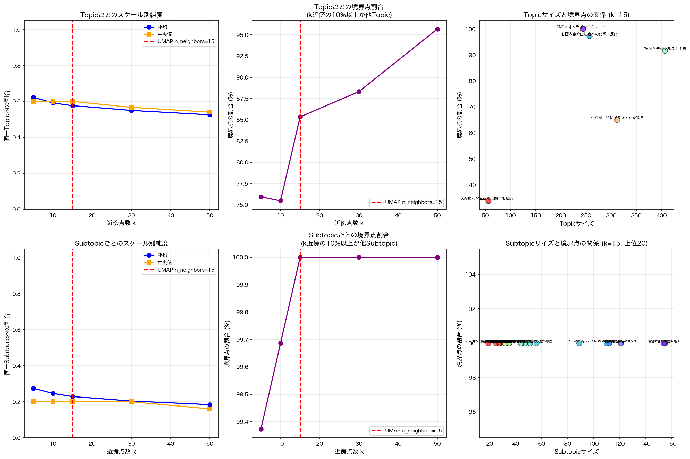

# YouTubeコメントのトピック分類と埋め込み空間の乖離

**日付**: 2025-10-28
**実験ディレクトリ**: `experiments/2025-10-28/`
**データセット**: youtube-no-votes-summary.json (1,276コメント)

## 背景：意味ベースの分類は高次元空間で分離しているか？

`2025-10-28-01-hdbscan-umap-scale-mismatch.md`の実験では、HDBSCANで抽出されたクラスタが高次元空間で部分的に混在していることを発見した（k=15での純度71.6%）。

今回の疑問：
> **Jigsaw SenseMakerが意味的に分類したトピック/サブトピックは、高次元空間で分離しているのか？**

YouTube動画のコメント1,276件について、**Jigsaw SenseMaker**（AIベースの意味分析システム）が以下のように分類している：
- **5つのTopic**（大カテゴリ）
- **24のSubtopic**（小カテゴリ）

これらのカテゴリを「クラスタ」と見なし、HDBSCANと同じ手法で高次元空間での近傍純度を分析した。

## 実験設定

### データセット

| 項目 | 値 |
|------|-----|
| コメント数 | 1,276件 |
| Embedding | OpenAI text-embedding-3-small (1536次元) |
| Topic数 | 5 |
| Subtopic数 | 24 |

### Topic分布

| Topic | コメント数 |
|-------|-----------|
| Polisとデジタル民主主義 | 407 |
| 生成AI（特にイラスト）を巡る議論 | 312 |
| 動画内容や出演者への感想・反応 | 257 |
| SNSとオンラインコミュニケーションのあり方 | 244 |
| 入湯税など具体例に関する解説・補足 | 56 |

### Subtopic分布（上位10）

| Subtopic | コメント数 |
|----------|-----------|
| Polisの課題・懸念点と限界 | 155 |
| 議論の性質や論点のズレ | 154 |
| 動画内の特定のネタや定番のやり取りへの反応 | 121 |
| Polisへの期待と応用可能性 | 112 |
| SNS上の対立構造とレスバトル | 110 |
| Polisの仕組みと基本概念 | 89 |
| クリエイターへの敬意と利用者のモラル | 56 |
| 既存SNSとの比較 | 51 |
| 出演者個人への言及・評価 | 47 |
| SNSの使い分けと代替サービスの模索 | 44 |

### 分析方法

HDBSCANと同じアプローチ（`analyze_hdbscan_scale.py`を参考）：
1. 複数のk（5, 10, 15, 30, 50）で近傍純度を分析
2. 各点のk近傍のうち、同一Topic/Subtopic内の点の割合を計算
3. 境界点（10%以上が他カテゴリ）の割合を計算

## 結果1: Topic分析（5カテゴリ）

### スケールごとの純度

| k | 平均純度 | 中央値 | 境界点割合 |
|---|---------|--------|-----------|
| **5** | **0.623** | 0.600 | **75.9%** |
| 10 | 0.591 | 0.600 | 75.5% |
| **15** | **0.576** | 0.600 | **85.3%** |
| 30 | 0.550 | 0.567 | 88.3% |
| 50 | 0.526 | 0.520 | 95.7% |

**重要**: k=15（UMAPのスケール）での平均純度は**57.6%**

### Topicごとの純度（k=15）

| Topic | サイズ | 平均純度 | 境界点割合 | 分離度 |
|-------|--------|---------|-----------|--------|
| 入湯税など具体例に関する解説・補足 | 56 | 0.775 | 33.9% | ✓ 良好 |
| 生成AI（特にイラスト）を巡る議論 | 312 | 0.768 | 65.1% | ✓ 比較的良好 |
| Polisとデジタル民主主義 | 407 | 0.613 | 91.6% | △ 中程度 |
| 動画内容や出演者への感想・反応 | 257 | 0.447 | 97.3% | ✗ 混在 |
| SNSとオンラインコミュニケーションのあり方 | 244 | 0.361 | 100.0% | ✗✗ 極めて混在 |

### 発見1: Topicによる純度の大きな差

- **具体的・限定的なトピック**（「入湯税」）: 純度77.5% → 明確に分離
- **抽象的・広範なトピック**（「SNS」）: 純度36.1% → 極めて混在

## 結果2: Subtopic分析（24カテゴリ）

### スケールごとの純度

| k | 平均純度 | 中央値 | 境界点割合 |
|---|---------|--------|-----------|
| **5** | **0.275** | 0.200 | **99.4%** |
| 10 | 0.246 | 0.200 | 99.7% |
| **15** | **0.229** | 0.200 | **100.0%** |
| 30 | 0.204 | 0.200 | 100.0% |
| 50 | 0.184 | 0.180 | 100.0% |

**衝撃的な結果**:
- k=15での平均純度は**22.9%**
- 境界点割合は**100%**（すべての点が境界点！）
- 15近傍のうち平均で**3-4点しか同じSubtopicではない**

### Subtopicごとの純度（k=15、上位10）

| Subtopic | サイズ | 平均純度 | 境界点割合 |
|----------|--------|---------|-----------|
| 現地払いの理由（手数料・キャンセル対応など） | 17 | 0.522 | 100.0% |
| 議論の性質や論点のズレ | 154 | 0.350 | 100.0% |
| クリエイターへの敬意と利用者のモラル | 56 | 0.345 | 100.0% |
| 単純な相槌や感情表現 | 28 | 0.317 | 100.0% |
| 入湯税の制度・仕組み | 12 | 0.300 | 100.0% |
| Polisの課題・懸念点と限界 | 155 | 0.296 | 100.0% |
| 著作権・法整備の問題 | 35 | 0.270 | 100.0% |
| 経済的影響と雇用の懸念 | 35 | 0.270 | 100.0% |
| Polisへの期待と応用可能性 | 112 | 0.235 | 100.0% |
| 利用者からの意見や宿泊税との関連 | 27 | 0.235 | 100.0% |

**全てのSubtopicで境界点100%** = 高次元空間で極めて混在

## 驚くべき発見：意味ベース分類 vs 密度ベースクラスタリング

### 比較：HDBSCAN vs SenseMaker Topic vs Subtopic

| 分類手法 | k=15純度 | 境界点割合 | 分離度 |
|---------|---------|-----------|--------|
| **HDBSCAN** (密度ベース) | **71.6%** | **72.9%** | △ 中程度 |
| **Topic** (意味ベース、5カテゴリ) | **57.6%** | **85.3%** | ✗ 混在 |
| **Subtopic** (意味ベース、24カテゴリ) | **22.9%** | **100%** | ✗✗ 極めて混在 |

### 逆転現象

```
密度ベース（HDBSCAN）:        純度 71.6% ✓ 比較的分離
意味ベース（SenseMaker Topic）:    純度 57.6% ✗ より混在
意味ベース（SenseMaker Subtopic）: 純度 22.9% ✗✗ 極めて混在
```

**Jigsaw SenseMakerの意味的分類よりも、密度ベースのHDBSCANの方が高次元空間で分離されている！**

## 可視化分析



### グラフの読み方

**上段（Topic）**:
- 左: スケールごとの純度 → k増加で純度低下（62% → 53%）
- 中央: 境界点割合 → k増加で急増（76% → 96%）
- 右: Topicサイズと境界点の関係 → サイズと関係なく、内容によって差が大きい

**下段（Subtopic）**:
- 左: スケールごとの純度 → k増加で急激に低下（28% → 18%）
- 中央: 境界点割合 → k=15以降は100%で横ばい
- 右: 上位20のSubtopic → ほぼ全て境界点100%

## なぜこうなるのか？理論的考察

### 1. トピックの曖昧性と重複

**具体例**:
```
コメント: 「Polisは面白いけど、SNSの対立構造を解決できるかは疑問」

SenseMakerの分類:
  - Topic: 「Polisとデジタル民主主義」（主要な話題に基づく）

埋め込み空間（text-embedding-3-small）:
  - 「Polis」と「SNS」の両方の意味を含む
  - 「対立構造」「解決」などの抽象概念も反映
  → 複数のトピックにまたがる意味的な位置に配置される
```

### 2. 意味的な近さ ≠ トピックカテゴリ

**高次元空間での意味的な近さ**:
```
「SNSの対立構造」 ←近い→ 「Polisで議論の質を改善」
```
→ 両者は意味的に関連（問題と解決策）
→ 埋め込み空間では近くに配置
→ でもSenseMakerは異なるTopic（「SNS」vs「Polis」）に分類

### 3. カテゴリ粒度の問題

**Subtopicの24カテゴリは細かすぎる**:
- 1カテゴリ平均53.2件（最小9件、最大155件）
- 15近傍を見ると、他のSubtopicが大量に混入
- → 純度22.9% = ほぼランダム

**HDBSCANの優位性**:
- データドリブンで密度の高い領域を発見
- カテゴリ数を事前に決めない
- → より自然なクラスタ境界

### 4. 意味的分類と密度ベース分類の違い

**Jigsaw SenseMakerの分類プロセス**（推定）:
1. コメントの意味を理解
2. **主要な話題やテーマ**を抽出
3. 事前定義されたカテゴリに割り当て

**埋め込みモデル（OpenAI）+ HDBSCAN**:
1. コメント全体を数値化（1536次元）
2. 密度の高い領域を発見
3. データドリブンにクラスタを抽出

**重要な違い**:
- **SenseMaker**: 意味的なテーマに基づく分類（トップダウン）
- **HDBSCAN**: 埋め込み空間の密度構造に基づく分類（ボトムアップ）
- **異なるembeddingモデル**: SenseMakerと今回の実験では異なるembeddingを使用している可能性
  - → 異なる埋め込み空間 → 異なるクラスタ構造

## 実用的な示唆

### 1. UMAP可視化の解釈

**Topic/Subtopicでグルーピングした可視化は**:
- 高次元空間では大きく混在している（Topic 57.6%、Subtopic 22.9%）
- → UMAP可視化でクラスタが引き裂かれたりオーバーラップするのは**正常**
- → むしろ、高次元の実態を正しく反映している

**間違った解釈**:
- 「UMAPの可視化が悪い」
- 「パラメータを調整すればきれいに分離できる」

**正しい解釈**:
- 「高次元空間で既に混在している」
- 「意味ベースの分類と使用するembedding空間は異なる構造を持つ可能性がある」
- 「SenseMakerと今回の実験で異なるembeddingモデルを使っている場合、結果が乖離するのは自然」

### 2. クラスタリング手法の選択

#### 意味ベース分類（Jigsaw SenseMaker）

**利点**:
- 意味的に解釈可能なカテゴリ
- 説明可能性が高い
- テーマに基づく整理

**欠点**:
- 使用するembeddingによっては埋め込み空間と不一致（今回：純度57.6%）
- 主要トピックのみに注目、副次的な内容は反映されない
- 複数トピックにまたがるコメントの扱いが困難
- カテゴリ数の決定が恣意的

#### 密度ベース（HDBSCAN）

**利点**:
- 使用するembedding空間で実際に密な領域を発見（今回：純度71.6%）
- 複雑な形状のクラスタも検出
- カテゴリ数を事前に決めない
- データドリブン

**欠点**:
- 解釈が難しい（クラスタの意味は事後的に付与）
- パラメータ（min_cluster_size等）の選択が必要
- テーマに基づく分類ではない

### 3. カテゴリ設計への示唆

**純度と抽象度の関係**（今回の結果から）:

| Topic | 抽象度 | 純度 | 示唆 |
|-------|--------|------|------|
| 入湯税 | 低（具体的） | 77.5% | ✓ 良好 |
| 生成AI | 中 | 76.8% | ✓ 比較的良好 |
| Polis | 中 | 61.3% | △ 中程度 |
| 動画感想 | 高 | 44.7% | ✗ 混在 |
| SNS | 高（抽象的） | 36.1% | ✗✗ 極めて混在 |

**設計原則**:
1. **具体的で限定的なカテゴリ** → 高次元空間でも分離しやすい
2. **抽象的で広範なカテゴリ** → 混在しやすい
3. **カテゴリ数は少なめに** → 24は多すぎる（純度22.9%）

### 4. ハイブリッドアプローチの提案

**ステップ1**: データドリブンで発見
```
HDBSCAN → 純度71.6%のクラスタを発見
```

**ステップ2**: 人間が解釈・ラベリング
```
各クラスタの代表的なコメントを読む
→ 意味的なラベルを付与
```

**ステップ3**: 検証
```
ラベル付きデータで純度を再計算
→ 人間のラベルが妥当か確認
```

## 実験環境の詳細

### スクリプト

1. **`analyze_youtube_comments.py`**:
   - JSONからコメント抽出
   - OpenAI APIでembedding生成（text-embedding-3-small）
   - UMAP可視化

2. **`analyze_youtube_comments_cluster_purity.py`**:
   - Topic/Subtopicごとの近傍純度分析
   - 複数スケール（k=5-50）での分析
   - クラスタごとの統計

### パラメータ

```python
# Embedding
model = "text-embedding-3-small"
dimensions = 1536

# 近傍分析
k_values = [5, 10, 15, 30, 50]
boundary_threshold = 0.9  # 10%以上が他カテゴリ

# UMAP（可視化用）
n_neighbors = 15
min_dist = 0.1
n_components = 2
```

### 結果ファイル

```
experiments/2025-10-28/
├── youtube-no-votes-summary.json           # 元データ
├── youtube_comments_embeddings.pkl         # Embeddings (1276 x 1536)
├── analyze_youtube_comments.py             # Embedding生成＋可視化
├── analyze_youtube_comments_cluster_purity.py  # 純度分析
├── youtube_comments_umap_by_topic.png      # Topic別UMAP可視化
├── youtube_comments_umap_by_subtopic.png   # Subtopic別UMAP可視化
└── youtube_comments_cluster_purity_analysis.png  # 純度分析グラフ
```

## 結論

### 主要な発見

1. **意味ベース分類 vs 密度ベースクラスタリング**（OpenAI embedding使用時）
   - HDBSCAN（密度ベース）: 71.6%
   - SenseMaker Topic（意味ベース）: 57.6%
   - SenseMaker Subtopic（意味ベース）: 22.9%

2. **カテゴリの抽象度と純度の逆相関**
   - 具体的（「入湯税」）: 77.5%
   - 抽象的（「SNS」）: 36.1%

3. **Subtopicの24カテゴリは細かすぎる**
   - 境界点100% = ほぼ全ての点が他カテゴリと隣接
   - 純度22.9% = ランダムに近い

4. **UMAP可視化の歪みは正常**
   - 高次元空間で既に混在しているものを、2次元で分離するのは不可能
   - 意味ベースの分類と使用するembedding空間は異なる構造を持つ可能性

### 理論的インサイト

**意味ベース分類（SenseMaker）の特性**:
- 主要な話題やテーマに基づく分類
- 複数トピックにまたがるコメントは主要トピックに割り当て
- 使用するembeddingモデルに依存

**密度ベース分類（HDBSCAN）の特性**:
- 使用するembedding空間で実際に密な領域を発見
- 主要/副次を区別せず、全体の意味的特徴を反映
- データドリブン、事前のカテゴリ定義不要

**重要な考察**:
- SenseMakerがどのembeddingモデルを使用しているかによって、今回の結果の解釈が変わる
- もしSenseMakerが異なるembeddingを使用している場合、純度の低さは当然
- 同じembeddingを使用している場合、意味的分類の粒度や基準が埋め込み空間の構造と合っていない可能性

**スケールの重要性**:
- k=5: Topic 62.3%、Subtopic 27.5%
- k=15: Topic 57.6%、Subtopic 22.9%
- k=50: Topic 52.6%、Subtopic 18.4%
- → スケールが大きくなるほど混在が顕在化

### 実務への示唆

#### 可視化

- 人間の分類でグルーピングした可視化は、高次元構造を反映していない可能性
- データドリブンクラスタリングの方が、embedding空間の実態に近い
- Supervised UMAPでラベルを強制すると、高次元構造が歪む

#### カテゴリ設計

- 具体的で限定的なカテゴリを使う
- 抽象的なカテゴリは避ける
- カテゴリ数は少なめに（5程度）

#### ハイブリッドアプローチ

1. データドリブンで発見（HDBSCAN等）
2. 人間が解釈・ラベリング
3. 純度を検証
4. 必要に応じてカテゴリを調整

## 関連研究

### 関連実験

- `notes/2025-10-28-01-hdbscan-umap-scale-mismatch.md`: HDBSCANのスケール分析
- `experiments/2025-10/`: HDBSCAN vs k-meansの可視化比較

### 次のステップ

1. **HDBSCANのクラスタに人間がラベルを付与**
   - データドリブンで発見したクラスタの解釈可能性を評価

2. **異なるembeddingモデルでの比較**
   - OpenAI vs sentence-transformers
   - モデルによって人間の分類との一致度は変わるか？

3. **トピック粒度の最適化**
   - 5カテゴリ（Topic）vs 24カテゴリ（Subtopic）
   - 最適なカテゴリ数は？

4. **複数ラベル分類の検討**
   - 1コメント = 1カテゴリではなく、複数カテゴリを許容
   - → 純度が向上するか？

## 付録：データ例

### Topic別の代表的なコメント例

**入湯税（純度77.5%）**:
- 明確に「入湯税」に関する議論
- 他のトピックと混在しにくい

**SNS（純度36.1%）**:
- SNSとPolisの関連を語るコメントが多い
- 動画感想と混ざるコメントも多い
- → 抽象的で広範なため混在

### Subtopic混在の例

**コメント**: 「Polisは面白いけど、Twitterのレスバトル文化を変えられるかは疑問」

**SenseMakerの分類**:
- Subtopic: 「Polisへの期待と応用可能性」（主要トピックに基づく）

**OpenAI embedding空間での位置**:
このコメントは以下の複数の意味的要素を含む：
- 「Polis」「面白い」→ Polisへの肯定的評価
- 「Twitter」「レスバトル文化」→ SNSの問題点
- 「変えられるか疑問」→ 懸念・限界の指摘

**15近傍に含まれる可能性のあるSubtopic**:
- 「SNS上の対立構造とレスバトル」
- 「既存SNSとの比較」
- 「Polisの課題・懸念点と限界」
- 「議論の性質や論点のズレ」

→ 1つのコメントが複数の意味的要素を含むため、OpenAI embedding空間では複数のSubtopicの境界に位置する
→ SenseMakerが使用するembeddingでも同様の混在が起きている可能性
